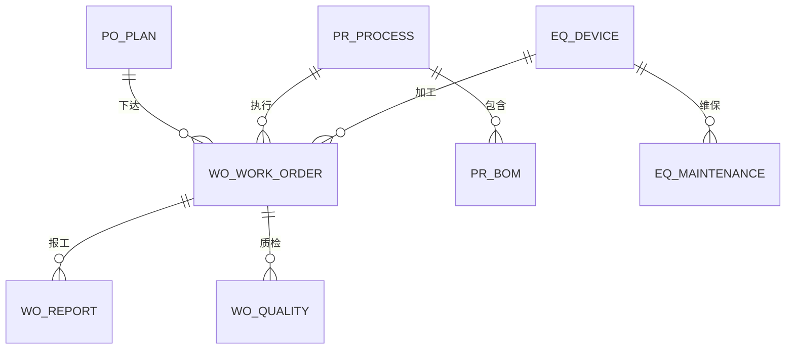

# 数据模型设计

本文档描述现状数据库结构与重构目标模型。现状结构来自 `zhizao-xietong/src/main/resources/db/migration/V1__init.sql`、`V2__seed.sql`、`V3__bom_version.sql`，目标结构为待评审设计，不包含已执行的迁移。

标注说明：`[代码实证]` 表示可从当前代码或迁移脚本直接核对；`[工程判断]` 表示基于现有规模与约束提出的设计取舍；`[待确认]` 表示需要用户拍板。

---

## 1. 现状模型

### 1.1 实体关系

当前数据库没有物理外键，表间关系由业务代码维护。下图按逻辑关系绘制。

关系说明：计划下达后生成工单；工单记录报工与质检；工艺通过 BOM 关联物料；设备通过维保记录和工单关联生产。`sys_user`、`sys_sequence`、`sys_audit_log` 为支撑表，不参与业务外键关系。`[代码实证]`

### 1.2 表与实体对照

| 表 | 实体 | Mapper | 作用 | 关键约束 |
|---|---|---|---|---|
| `eq_device` | `Device` | `DeviceMapper` | 设备台账 | `uk_device_no`，逻辑删除 |
| `mt_material` | `Material` | `MaterialMapper` | 物料与库存 | `uk_mat_code`，`kit_status` 索引 |
| `pr_process` | `Process` | `ProcessMapper` | 工艺主数据 | `uk_process_no` |
| `pr_bom` | `BomItem` | `BomItemMapper` | 工艺物料清单 | 仅 `process_id` 普通索引，无版本唯一约束 |
| `po_plan` | `Plan` | `PlanMapper` | 生产计划 | `uk_plan_order_no`，状态索引 |
| `wo_work_order` | `WorkOrder` | `WorkOrderMapper` | 生产工单 | `uk_order_no`，`plan_id`/`status` 索引，无版本列 |
| `wo_report` | `WorkOrderReport` | `WorkOrderReportMapper` | 报工记录 | `uk_report_no`，`order_id` 索引 |
| `wo_quality` | `QualityRecord` | `QualityRecordMapper` | 质检记录 | `uk_quality_no`，`order_id` 索引 |
| `eq_maintenance` | `MaintenanceRecord` | `MaintenanceRecordMapper` | 点检/维修 | `uk_mt_no`，`device_id` 索引 |
| `sys_user` | `SysUser` | `SysUserMapper` | 用户与角色 | `uk_username` |
| `sys_sequence` | `Sequence` | `SequenceMapper` | 编号序列 | 主键 `seq_name` |
| `sys_audit_log` | `AuditLog` | `AuditLogMapper` | 写操作审计 | `created_at` 索引，无保留策略 |

### 1.3 关键字段现状

| 表 | 字段 | 现状 | 问题 |
|---|---|---|---|
| `wo_work_order` | `status` | `PENDING/IN_PRODUCTION/PENDING_QC/FINISHED` | 无流转历史，无法追溯操作人和时间 |
| `wo_work_order` | `workshop` | 字符串，下达时固定写「一车间」 | 车间不是数据域，无法做权限隔离 |
| `wo_report` | `qty`、`qualified_qty`、`defect_qty` | 均可为空或任意整数 | 无正数校验、无累计上限、无幂等键 |
| `wo_quality` | `result` | 字符串 `PASS/FAIL` | 质检记录先落库再校验结论，非法值依赖事务回滚 |
| `pr_process` | `device_mat_req` | 逗号分隔的描述字符串 | 没有工序、工步、标准工时结构 |
| `pr_bom` | `version` | V3 增加，默认 1 | 无 `(process_id, version, mat_code)` 唯一约束 |
| `eq_device` | `status` | 由 MQTT 或手工接口修改 | 无 `last_seen_at`，无法判断设备是否失联 |
| `sys_user` | `role` | `ADMIN/USER` | 无启用状态、无令牌版本、无数据域 |
| `sys_audit_log` | `params` | 截断到 1000 字符 | 无结果状态、耗时、链路标识 |

---

## 2. 目标模型

目标模型按「先补可靠性，再补业务完整性，最后补旁路能力」的顺序演进。所有变更通过 Flyway 前向迁移完成，不修改已执行的历史脚本。

### 2.1 新增表

#### 2.1.1 `eq_telemetry` 设备遥测时序

| 字段 | 类型 | 约束 | 设计意图 |
|---|---|---|---|
| `id` | BIGINT | PK, AUTO_INCREMENT | 代理键 |
| `device_id` | BIGINT | NOT NULL | 设备主键，查询主路径 |
| `device_no` | VARCHAR(32) | NOT NULL | 冗余设备编号，便于按编号导出与排障 |
| `status` | VARCHAR(16) | NULL | 上报时的设备状态 |
| `temperature` | DECIMAL(6,2) | NULL | 温度，保留两位 |
| `rpm` | INT | NULL | 转速 |
| `current` | DECIMAL(6,2) | NULL | 电流 |
| `reported_at` | DATETIME(3) | NOT NULL | 设备侧上报时间，毫秒精度 |
| `received_at` | DATETIME(3) | NOT NULL DEFAULT CURRENT_TIMESTAMP(3) | 服务端接收时间，用于计算链路延迟 |
| `ingest_key` | VARCHAR(64) | NULL | 上报幂等键；有值时唯一 |
| `source` | VARCHAR(16) | NOT NULL DEFAULT 'MQTT' | `MQTT` / `HTTP` / `SIMULATED` |

索引与保留：

- 联合索引 `idx_device_time (device_id, reported_at)` 支撑单设备时间范围查询。
- 联合索引 `idx_device_no_time (device_no, reported_at)` 支撑按编号导出。
- 唯一索引 `uk_ingest_key (ingest_key)`，允许 NULL 重复；用于设备重发去重。
- 数据量按「设备数 × 上报频率 × 保留天数」估算。当前规模（数十台设备、秒级上报）下 MySQL 单表可支撑，按月分区或定期归档二选一，推荐先按 90 天定期删除。`[工程判断]`

#### 2.1.2 `eq_device_credential` 设备凭证（S1 已落地）

| 字段 | 类型 | 约束 | 设计意图 |
|---|---|---|---|
| `id` | BIGINT | PK | 代理键 |
| `device_id` | BIGINT | NOT NULL, UNIQUE | 一设备一凭证 |
| `key_id` | VARCHAR(32) | NOT NULL, UNIQUE | 凭证标识，随请求头传递 |
| `secret_ciphertext` | VARCHAR(256) | NOT NULL | 设备密钥密文，AES-256-GCM 加密后存储，不落明文 |
| `enabled` | TINYINT | NOT NULL DEFAULT 1 | 吊销开关 |
| `created_at` | DATETIME | NOT NULL | 签发时间 |
| `last_used_at` | DATETIME | NULL | 最近使用时间 |

设备上报不再复用用户 JWT，改用 `key_id + HMAC-SHA256(body, secret)` 校验。这样设备凭证泄露的影响面仅限单台设备，用户令牌也不会下发到设备侧。`[工程判断]`

服务端需要用密钥重算 HMAC，因此密钥必须可逆保存，采用 AES-256-GCM 加密而不是哈希；主密钥来自环境变量 `DEVICE_CREDENTIAL_KEY`，未配置时拒绝签发与校验。`[已决策]`

#### 2.1.3 `pr_operation` 工序

| 字段 | 类型 | 约束 | 设计意图 |
|---|---|---|---|
| `id` | BIGINT | PK | 代理键 |
| `process_id` | BIGINT | NOT NULL | 所属工艺 |
| `seq_no` | INT | NOT NULL | 工序顺序，工艺内唯一 |
| `op_code` | VARCHAR(32) | NOT NULL | 工序编码 |
| `op_name` | VARCHAR(64) | NOT NULL | 工序名称 |
| `device_type` | VARCHAR(32) | NULL | 所需设备类型 |
| `std_hours` | DECIMAL(8,2) | NULL | 标准工时，用于排产估算 |
| `quality_required` | TINYINT | NOT NULL DEFAULT 0 | 是否必须质检 |

约束：`uk_process_seq (process_id, seq_no)`、`uk_process_op_code (process_id, op_code)`。工序是工艺路线的最小可排产单元，没有工序就无法把计划拆到设备时间窗。`[工程判断]`

#### 2.1.4 `wo_status_history` 工单状态流转历史

| 字段 | 类型 | 约束 | 设计意图 |
|---|---|---|---|
| `id` | BIGINT | PK | 代理键 |
| `order_id` | BIGINT | NOT NULL | 工单 |
| `from_status` | VARCHAR(16) | NOT NULL | 流转前状态 |
| `to_status` | VARCHAR(16) | NOT NULL | 流转后状态 |
| `operator` | VARCHAR(32) | NULL | 操作人，缺省 `system` |
| `remark` | VARCHAR(255) | NULL | 开工/报工/质检说明 |
| `created_at` | DATETIME | NOT NULL DEFAULT CURRENT_TIMESTAMP | 发生时间 |

索引：`idx_order_time (order_id, created_at)`。历史表只追加，不更新、不删除；它是状态机审计的事实来源。`[工程判断]`

#### 2.1.5 `sys_outbox` 领域事件发件箱（可选）

| 字段 | 类型 | 约束 | 设计意图 |
|---|---|---|---|
| `id` | BIGINT | PK | 代理键 |
| `aggregate_type` | VARCHAR(32) | NOT NULL | 聚合类型，如 `WORK_ORDER` |
| `aggregate_id` | BIGINT | NOT NULL | 聚合 ID |
| `event_type` | VARCHAR(64) | NOT NULL | 事件类型 |
| `payload` | JSON | NOT NULL | 事件内容 |
| `status` | VARCHAR(16) | NOT NULL DEFAULT 'PENDING' | `PENDING/SENT/FAILED` |
| `created_at` | DATETIME | NOT NULL | 产生时间 |
| `sent_at` | DATETIME | NULL | 发送时间 |

当前没有 Kafka/RocketMQ。若后续需要把工单完工事件推给报表或 AI 旁路，用发件箱表保证「业务落库」和「事件投递」一致，比直接双写可靠。是否引入取决于是否出现第二个消费者；2026-11-06 已决策暂不引入，保留预案。`[已决策]`

#### 2.1.6 AI 旁路表（最后阶段，可选）

| 表 | 关键字段 | 用途 |
|---|---|---|
| `ai_suggestion_log` | `id`、`scene`、`subject_type`、`subject_id`、`input_digest`、`output_json`、`model`、`latency_ms`、`created_at` | 记录建议内容与来源，便于复核；不存完整用户原文 |
| `ai_query_audit` | `id`、`username`、`question`、`generated_sql`、`row_count`、`elapsed_ms`、`status`、`created_at` | Text-to-SQL 审计，支撑安全审查与慢查询治理 |

两张表只追加，保留 180 天；AI 不可用时不影响主表写入。`[工程判断]`

### 2.2 调整现有表

#### `eq_device`

| 变更 | 设计意图 |
|---|---|
| 新增 `last_seen_at DATETIME(3)` | 判断设备在线；超过阈值未上报即视为离线。S1 已落地 |
| 新增 `protocol VARCHAR(16)` | 区分 `MQTT/HTTP/OPC_UA`，为多协议接入留位。待数据域阶段落地 |
| 新增 `workshop VARCHAR(32)` | 设备归属车间，与工单车间口径一致。待数据域阶段落地 |

#### `pr_process`

| 变更 | 设计意图 |
|---|---|
| 新增 `version INT NOT NULL DEFAULT 1` | 工艺版本，发布后冻结 |
| 新增 `published_at DATETIME`、`published_by VARCHAR(32)` | 发布审计 |
| 新增 `effective_from DATE` | 生效日期，支持新旧版本并行 |

#### `pr_bom`

| 变更 | 设计意图 |
|---|---|
| 新增 `unit VARCHAR(16)` | 计量单位，避免「1 个」与「1 千克」混用 |
| 新增 `scrap_rate DECIMAL(5,4) DEFAULT 0` | 损耗率，齐套计算口径可解释 |
| 唯一索引 `uk_process_version_mat (process_id, version, mat_code)` | 同一版本同一物料只允许一行 |
| 索引 `idx_process_version (process_id, version)` | 按版本读取 BOM |

#### `wo_work_order`

| 变更 | 设计意图 |
|---|---|
| 新增 `version INT NOT NULL DEFAULT 0` | MyBatis-Plus 乐观锁，防止并发重复开工/报工 |
| 新增 `actual_start`、`actual_end` | 实际开工/完工时间，支撑节拍分析 |
| 新增 `qty_done`、`qty_qualified`、`qty_defect` | 累计数量，避免每次汇总报工表 |
| 新增 `process_version INT` | 锁定工单执行时的工艺版本 |

#### `wo_report`

| 变更 | 设计意图 |
|---|---|
| 新增 `idempotency_key VARCHAR(64)` + 唯一索引 | 移动端弱网重试不产生重复报工 |
| 新增 `report_type VARCHAR(16) NOT NULL DEFAULT 'PRODUCTION'` | 区分生产报工与返工报工 |
| 约束 `qty > 0`、`qualified_qty + defect_qty = qty`、`qty` 累计不超过工单数量 | 报工数量可信 |

#### `wo_quality`

| 变更 | 设计意图 |
|---|---|
| 新增 `qty_checked`、`qty_passed`、`qty_failed` | 支持抽检与全检 |
| 新增 `defect_reason_code VARCHAR(32)` | 不良原因可统计 |
| 结论改为枚举校验，校验在落库前完成 | 非法结论不产生脏记录 |

#### `sys_user`

| 变更 | 设计意图 |
|---|---|
| 新增 `enabled TINYINT NOT NULL DEFAULT 1` | 禁用用户立即失效 |
| 新增 `token_version INT NOT NULL DEFAULT 0` | 改密或禁用后旧令牌失效 |
| 新增 `workshop_scope VARCHAR(128)` | 数据域，逗号分隔车间；为空表示全部 |
| 新增 `last_login_at` | 登录审计 |

#### `sys_audit_log`

| 变更 | 设计意图 |
|---|---|
| 新增 `trace_id VARCHAR(64)` | 串联一次请求的日志 |
| 新增 `result_status VARCHAR(16)` | `SUCCESS/FAILED` |
| 新增 `duration_ms INT` | 慢操作识别 |
| 新增 `error_code VARCHAR(32)` | 失败原因分类 |

### 2.3 一致性规则

| 规则 | 落地方式 |
|---|---|
| 工单状态流转与历史记录同事务 | `updateById` 返回 0 视为冲突并抛异常，历史在同一事务内插入 |
| 报工数量不超工单数量 | `SELECT ... FOR UPDATE` 汇总已报数量或在工单行上维护累计字段，二选一；推荐累计字段 + 乐观锁 |
| 设备上报幂等 | `ingest_key` 唯一索引，重复键忽略并返回成功 |
| BOM 版本不可变 | 发布后禁止更新，只能新建版本 |
| 审计失败不影响业务 | 审计写入独立 `try/catch`，但需要记录告警计数 |
| 时序数据可丢失 | 遥测写入失败不阻断设备状态更新，落 WARN 日志并计数 |

---

## 3. 迁移顺序

| 迁移 | 内容 | 依赖 |
|---|---|---|
| `V4__device_online.sql` | `eq_device.last_seen_at`（S1 已落地）；`protocol`、`workshop` 随数据域迁移补充 | 无 |
| `V5__device_credential.sql` | 新建 `eq_device_credential` | 无 |
| `V6__device_telemetry.sql` | 新建 `eq_telemetry` | `V4` 可并行 |
| `V7__work_order_consistency.sql` | `version`、累计数量、`wo_status_history`、报工约束 | 与 `V4` 可并行 |
| `V8__process_operation.sql` | 新建 `pr_operation`，`pr_process` 版本字段 | 无 |
| `V9__identity_scope.sql` | `sys_user` 启用状态、令牌版本、车间范围 | 无 |
| `V10__audit_enhance.sql` | 审计字段扩展与索引 | 无 |
| `V11__ai_sidecar.sql` | AI 审计表（最后阶段） | `V7`、`V9` |

每个迁移只做一件事，可单独回滚到上一版本；生产环境执行前先备份，禁止在迁移中做数据回填与结构变更混合。`[工程判断]`
