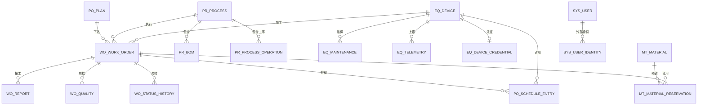

# 数据模型设计

本文档描述现状数据库结构与重构目标模型。现状结构来自 `zhizao-xietong/src/main/resources/db/migration/V1__init.sql` 至 `V32__auth_event.sql`，共 **26 张表 + 5 个只读视图**（迁移号到 V32，其中 V27、V28 为空号）；目标结构为待评审设计，不包含未执行的迁移。

标注说明：`[代码实证]` 表示可从当前代码或迁移脚本直接核对；`[工程判断]` 表示基于现有规模与约束提出的设计取舍；`[待确认]` 表示需要用户拍板。

---

## 1. 现状模型

### 1.1 实体关系

当前数据库没有物理外键，表间关系由业务代码维护。下图按逻辑关系绘制。



关系说明：计划下达后生成工单；工单记录报工、质检、状态流转与排程，并在开工时预占物料；工艺通过 BOM 关联物料；设备通过维保记录、遥测与排程时间窗关联生产；SSO 账号通过 `sys_user_identity` 关联外部身份。`sys_user`、`sys_sequence`、`sys_audit_log` 等支撑表不参与业务外键关系。`[代码实证]`

### 1.2 表与实体对照

| 表 | 实体 | Mapper | 作用 | 关键约束 |
|---|---|---|---|---|
| `eq_device` | `Device` | `DeviceMapper` | 设备台账 | `uk_device_no`，逻辑删除 |
| `mt_material` | `Material` | `MaterialMapper` | 物料与库存 | `uk_mat_code`，`kit_status` 索引 |
| `mt_material_reservation` | `MaterialReservation` | `MaterialReservationMapper` | 开工时按 BOM 预占库存，支撑齐套 | `uk_work_order_mat (work_order_id, mat_code)`，`(mat_code, status)` 索引 |
| `pr_process` | `Process` | `ProcessMapper` | 工艺主数据，一行即一个版本 | `uk_process_no_version (process_no, version)`；单列 `uk_process_no` 已于 V15 删除 |
| `pr_process_operation` | `ProcessOperation` | `ProcessOperationMapper` | 工艺版本的工序路线 | `process_id` 普通索引，`(process_id, seq)` 由服务层保证不重复；`setup_hours` 记录换型工时（V19） |
| `pr_bom` | `BomItem` | `BomItemMapper` | 工艺物料清单，按 `process_id` 归属版本 | 仅 `process_id` 普通索引 |
| `po_plan` | `Plan` | `PlanMapper` | 生产计划 | `uk_plan_order_no`，状态索引，`workshop` 索引 |
| `po_schedule_entry` | `ScheduleEntry` | `ScheduleEntryMapper` | 有限产能排程结果与冲突原因 | `work_order_id`、`(device_id, start_time)`、`status` 索引；派生数据，无逻辑删除 |
| `wo_work_order` | `WorkOrder` | `WorkOrderMapper` | 生产工单 | `uk_order_no`，`plan_id`/`status` 索引；`process_version` 记录开工时锁定的工艺版本；`qty_rework` 记录质检失败释放的返工额度（V16） |
| `wo_status_history` | `WorkOrderStatusHistory` | `WorkOrderStatusHistoryMapper` | 工单状态流转历史 | `(order_id, created_at)` 索引，只追加 |
| `wo_report` | `WorkOrderReport` | `WorkOrderReportMapper` | 报工记录 | `uk_report_no`，`order_id` 索引，`(order_id, idempotency_key)` 唯一 |
| `wo_quality` | `QualityRecord` | `QualityRecordMapper` | 质检记录 | `uk_quality_no`，`order_id` 索引 |
| `fg_inbound_order` | `FinishedGoodsInbound` | `FinishedGoodsInboundMapper` | 成品入库单：工单完工后生成的待入库、已入库或已取消记录 | `uk_inbound_work_order (work_order_id)` 保证一单一条；`(workshop, status)`、`product_code` 索引（V26） |
| `fg_finished_stock` | `FinishedGoodsStock` | `FinishedGoodsStockMapper` | 成品库存：按产品编码 + 车间累计合格入库数 | `uk_stock_product_workshop (product_code, workshop)`，`workshop` 索引；确认入库时原子累加（V31） |
| `eq_alarm_rule` | `AlarmRule` | `AlarmRuleMapper` | 设备报警规则 | `uk_rule_device_type_metric (device_id, rule_type, metric)`，`(rule_type, enabled)` 索引（V29） |
| `eq_alarm_record` | `AlarmRecord` | `AlarmRecordMapper` | 设备报警记录 | `uk_alarm_active (device_id, rule_type, metric, active_flag)` 保证同一指标同时只有一条活动报警（V30） |
| `eq_maintenance` | `MaintenanceRecord` | `MaintenanceRecordMapper` | 点检/维修 | `uk_mt_no`，`device_id` 索引 |
| `eq_telemetry` | `DeviceTelemetryRecord` | `DeviceTelemetryMapper` | 设备遥测时序 | `(device_id, reported_at)` 索引，唯一键 `uk_device_ingest_key (device_id, ingest_key)`（V17） |
| `eq_device_credential` | `DeviceCredential` | `DeviceCredentialMapper` | 设备凭证 | `device_id` 唯一、`key_id` 唯一 |
| `sys_user` | `SysUser` | `SysUserMapper` | 用户、角色、启停、车间数据域与登录来源 | `uk_username`；`role` 取 `ADMIN/USER/WORKER`；`enabled`、`token_version`、`workshop_scope` 由 V11 增加，V13 将非管理员范围重置为 `NULL`；`must_change_password`（V23）、`auth_source`（V24） |
| `sys_user_identity` | `SysUserIdentity` | `SysUserIdentityMapper` | 外部身份映射（SSO） | `uk_provider_external (provider, external_id)`、`uk_user_provider (user_id, provider)`；`department_ids` 仅作展示，`suggested_workshop` 已由 V25 删除 |
| `sys_sequence` | `Sequence` | `SequenceMapper` | 编号序列 | 主键 `seq_name` |
| `sys_audit_log` | `AuditLog` | `AuditLogMapper` | 写操作审计 | `created_at`、`(username, created_at)`、`uri` 索引；`success`、`error_message` 由 V20 增加；无保留策略 |
| `sys_auth_event` | 无实体，`JdbcTemplate` | — | 认证事件审计：登录、登出、SSO 换票的成功与失败 | `(created_at)`、`(username, created_at)`、`result_code` 索引；只记事件类型、结果码、原因摘要与 IP，不存请求体（V32） |
| `ai_suggestion_log` | 无实体，`JdbcTemplate` | — | AI 建议留痕 | `(scene, created_at)` 索引；只存场景、目标、证据数与摘要，不存 prompt 原文 |
| `ai_query_audit` | 无实体，`JdbcTemplate` | — | AI 数据问答审计 | `created_at`、`username` 索引；问题只存 SHA-256 摘要，保存实际执行的只读 SQL |

V14 另创建 5 个只读视图：`v_work_order_summary`、`v_device_status`、`v_quality_summary`、`v_plan_progress`、`v_kit_status`，供 Text-to-SQL 白名单校验与只读查询使用。视图不暴露 `sys_user`、设备凭证、遥测原始表等敏感数据。`[代码实证]`

### 1.3 关键字段现状

| 表 | 字段 | 现状 | 问题 |
|---|---|---|---|
| `wo_work_order` | `status` | `PENDING/IN_PRODUCTION/PENDING_QC/FINISHED` | 流转改由 `wo_status_history` 留痕，操作人与时间可追溯 |
| `wo_work_order` | `workshop` | 字符串，下达时必填 | S6 起作为数据域依据：非管理员只能读写本车间数据 |
| `wo_report` | `qty`、`qualified_qty`、`defect_qty` | 服务层校验正数、`qualified + defect = qty`、累计不超过工单数量 + 返工额度 | S3 已补累计上限与幂等键 `idempotency_key` |
| `wo_quality` | `result` | 字符串 `PASS/FAIL` | S3 已改为结论校验前置，非法值不产生记录 |
| `pr_process` | `device_mat_req` | 逗号分隔的描述字符串 | 工序结构已由 `pr_process_operation` 承接，该字段保留为辅助描述 |
| `pr_bom` | `version` | V3 增加，S4 起废弃 | V21 已删除该列；版本只按 `process_id` 关联工艺版本行 |
| `eq_device` | `status` | 由 MQTT 或手工接口修改 | S1 已补 `last_seen_at`；S6 已补 `workshop` 作为数据域 |
| `sys_user` | `role` | `ADMIN/USER/WORKER` | `WORKER` 为 SSO 首次建号的默认角色；`auth_source` 区分 `LOCAL/SSO`，`must_change_password` 只对存量管理员置 1 |
| `sys_audit_log` | `params` | 截断到 1000 字符 | V20 已补 `success` 与 `error_message`，失败操作可检索；链路标识仍未落地 |

---

## 2. 目标模型

目标模型按「先补可靠性，再补业务完整性，最后补旁路能力」的顺序演进。所有变更通过 Flyway 前向迁移完成，不修改已执行的历史脚本。

### 2.1 新增表

#### 2.1.1 `eq_telemetry` 设备遥测时序（S2 已落地）

| 字段 | 类型 | 约束 | 设计意图 |
|---|---|---|---|
| `id` | BIGINT | PK, AUTO_INCREMENT | 代理键 |
| `device_id` | BIGINT | NOT NULL | 设备主键，查询主路径 |
| `device_no` | VARCHAR(32) | NOT NULL | 冗余设备编号，便于按编号导出与排障 |
| `status` | VARCHAR(16) | NULL | 上报时的设备状态 |
| `temperature` | DECIMAL(6,2) | NULL | 温度，保留两位 |
| `rpm` | INT | NULL | 转速 |
| `current` | DECIMAL(6,2) | NULL | 电流 |
| `reported_at` | DATETIME(3) | NOT NULL | 设备侧上报时间，毫秒精度 |
| `received_at` | DATETIME(3) | NOT NULL DEFAULT CURRENT_TIMESTAMP(3) | 服务端接收时间，用于计算链路延迟 |
| `ingest_key` | VARCHAR(64) | NULL | 上报幂等键；有值时唯一 |
| `source` | VARCHAR(16) | NOT NULL DEFAULT 'MQTT' | `MQTT` / `HTTP` / `SIMULATED` |

索引与保留：

- 联合索引 `idx_device_time (device_id, reported_at)` 支撑单设备时间范围查询。
- 联合索引 `idx_device_no_time (device_no, reported_at)` 支撑按编号导出。
- 唯一索引 `uk_device_ingest_key (device_id, ingest_key)`（V17 由单列 `uk_ingest_key` 改来），允许 NULL 重复；用于设备重发去重，并避免不同设备的自增 `messageId` 互相撞键。
- 数据量按「设备数 × 上报频率 × 保留天数」估算。当前规模（数十台设备、秒级上报）下 MySQL 单表可支撑，按月分区或定期归档二选一，推荐先按 90 天定期删除。`[工程判断]`

#### 2.1.2 `eq_device_credential` 设备凭证（S1 已落地）

| 字段 | 类型 | 约束 | 设计意图 |
|---|---|---|---|
| `id` | BIGINT | PK | 代理键 |
| `device_id` | BIGINT | NOT NULL, UNIQUE | 一设备一凭证 |
| `key_id` | VARCHAR(32) | NOT NULL, UNIQUE | 凭证标识，随请求头传递 |
| `secret_ciphertext` | VARCHAR(256) | NOT NULL | 设备密钥密文，AES-256-GCM 加密后存储，不落明文 |
| `enabled` | TINYINT | NOT NULL DEFAULT 1 | 吊销开关 |
| `created_at` | DATETIME | NOT NULL | 签发时间 |
| `last_used_at` | DATETIME | NULL | 最近使用时间 |

设备上报不再复用用户 JWT，改用 `key_id + HMAC-SHA256(body, secret)` 校验。这样设备凭证泄露的影响面仅限单台设备，用户令牌也不会下发到设备侧。`[工程判断]`

服务端需要用密钥重算 HMAC，因此密钥必须可逆保存，采用 AES-256-GCM 加密而不是哈希；主密钥来自环境变量 `DEVICE_CREDENTIAL_KEY`，未配置时拒绝签发与校验。`[已决策]`

#### 2.1.3 `pr_process_operation` 工序路线（S4 已落地）

| 字段 | 类型 | 约束 | 设计意图 |
|---|---|---|---|
| `id` | BIGINT | PK | 代理键 |
| `process_id` | BIGINT | NOT NULL | 所属工艺版本（`pr_process.id`） |
| `seq` | INT | NOT NULL | 工序顺序，从 1 开始 |
| `operation_name` | VARCHAR(64) | NOT NULL | 工序名称 |
| `device_type` | VARCHAR(64) | NULL | 所需设备类型 |
| `est_hours` | DECIMAL(6,2) | NULL | 单件标准工时（小时） |
| `setup_hours` | DECIMAL(6,2) | NOT NULL DEFAULT 0 | 同设备换型工时（小时），V19 增加，排程计入时间窗 |
| `created_at` | DATETIME | NOT NULL DEFAULT CURRENT_TIMESTAMP | 创建时间 |
| `deleted` | TINYINT | NOT NULL DEFAULT 0 | 逻辑删除 |

索引：`idx_process_id (process_id)`。同一工艺版本内 `seq` 不重复由 `ProcessOperationService` 在写入前校验；未加数据库唯一索引，避免存量回填与逻辑删除叠加时阻断迁移。`[代码实证]`

V9 为存量工艺回填一条「默认工序」（`seq = 1`），保证迁移后旧工艺仍可提交审批与排产。

#### 2.1.4 `wo_status_history` 工单状态流转历史（S3 已落地）

| 字段 | 类型 | 约束 | 设计意图 |
|---|---|---|---|
| `id` | BIGINT | PK | 代理键 |
| `order_id` | BIGINT | NOT NULL | 工单 |
| `from_status` | VARCHAR(16) | NOT NULL | 流转前状态 |
| `to_status` | VARCHAR(16) | NOT NULL | 流转后状态 |
| `operator` | VARCHAR(32) | NULL | 操作人，缺省 `system` |
| `remark` | VARCHAR(255) | NULL | 开工/报工/质检说明 |
| `created_at` | DATETIME | NOT NULL DEFAULT CURRENT_TIMESTAMP | 发生时间 |

索引：`idx_order_time (order_id, created_at)`。历史表只追加，不更新、不删除；它是状态机审计的事实来源。`[工程判断]`

#### 2.1.5 `po_schedule_entry` 有限产能排程结果（S5 已落地）

| 字段 | 类型 | 约束 | 设计意图 |
|---|---|---|---|
| `id` | BIGINT | PK, AUTO_INCREMENT | 代理键 |
| `work_order_id` | BIGINT | NOT NULL | 工单 |
| `plan_id` | BIGINT | NOT NULL | 来源计划，便于按交期追溯 |
| `operation_seq` | INT | NULL | 工序顺序；未绑定工序时为空 |
| `operation_name` | VARCHAR(64) | NULL | 工序名称快照 |
| `device_type` | VARCHAR(64) | NULL | 占用设备类型，回答「占的哪类产能」 |
| `device_id` | BIGINT | NULL | 落位设备；无法排入时为空 |
| `start_time` | DATETIME | NULL | 占用起始时间 |
| `end_time` | DATETIME | NULL | 占用结束时间 |
| `duration_hours` | DECIMAL(8,2) | NULL | 工序累计有效工时；跨天不等于首尾时间差 |
| `estimated` | TINYINT | NOT NULL DEFAULT 0 | 工时为显式开启的估算值；标准工时缺失时默认拒绝排程，不会写入估算 |
| `queue_rank` | INT | NOT NULL | 本次排程队列位置，从 1 开始 |
| `rank_basis` | VARCHAR(255) | NOT NULL | 位置依据：交期与优先级 |
| `status` | VARCHAR(16) | NOT NULL | `SCHEDULED` / `UNSCHEDULED` |
| `conflict_code` | VARCHAR(32) | NULL | 无法排入时的业务码 |
| `message` | VARCHAR(255) | NULL | 可读原因或落位说明 |
| `created_at` | DATETIME | NOT NULL DEFAULT CURRENT_TIMESTAMP | 本次运行写入时间 |

索引：`idx_work_order (work_order_id)`、`idx_device_time (device_id, start_time)`、`idx_status (status)`。

该表是派生数据：每次排程先物理删除 `PENDING` 工单的旧结果再重建；在产与已完工工单的结果保留，作为已占用产能与追溯依据。不设逻辑删除，避免重复运行后逻辑删除行不断累积。`[工程判断]`

#### 2.1.6 `sys_outbox` 领域事件发件箱（可选）

| 字段 | 类型 | 约束 | 设计意图 |
|---|---|---|---|
| `id` | BIGINT | PK | 代理键 |
| `aggregate_type` | VARCHAR(32) | NOT NULL | 聚合类型，如 `WORK_ORDER` |
| `aggregate_id` | BIGINT | NOT NULL | 聚合 ID |
| `event_type` | VARCHAR(64) | NOT NULL | 事件类型 |
| `payload` | JSON | NOT NULL | 事件内容 |
| `status` | VARCHAR(16) | NOT NULL DEFAULT 'PENDING' | `PENDING/SENT/FAILED` |
| `created_at` | DATETIME | NOT NULL | 产生时间 |
| `sent_at` | DATETIME | NULL | 发送时间 |

当前没有 Kafka/RocketMQ。若后续需要把工单完工事件推给报表或 AI 旁路，用发件箱表保证「业务落库」和「事件投递」一致，比直接双写可靠。是否引入取决于是否出现第二个消费者；2026-11-06 已决策暂不引入，保留预案。`[已决策]`

#### 2.1.7 AI 旁路表（最后阶段，可选）

| 表 | 关键字段 | 用途 |
|---|---|---|
| `ai_suggestion_log` | `id`、`scene`、`subject_type`、`subject_id`、`input_digest`、`output_json`、`model`、`latency_ms`、`created_at` | 记录建议内容与来源，便于复核；不存完整用户原文 |
| `ai_query_audit` | `id`、`username`、`question`、`generated_sql`、`row_count`、`elapsed_ms`、`status`、`created_at` | Text-to-SQL 审计，支撑安全审查与慢查询治理 |

两张表只追加，保留 180 天；AI 不可用时不影响主表写入。`[工程判断]`

#### 2.1.8 成品入库与库存（已落地，V26 / V31）

`fg_inbound_order`：

| 字段 | 类型 | 约束 | 说明 |
|---|---|---|---|
| `id` | BIGINT | PK | 代理键 |
| `work_order_id` | BIGINT | NOT NULL, UK | `wo_work_order.id`；一张工单最多一条入库单，重复完工由唯一键忽略 |
| `product_code` | VARCHAR(32) | NOT NULL | 成品编码，取自工单 |
| `qty` | INT | NOT NULL | 待入库数量 = `min(计划数, 合格数) − 已入库数`，不大于 0 时不生成 |
| `batch` | VARCHAR(64) | NOT NULL | 默认「工单号-yyyyMMdd」，确认时可覆盖 |
| `workshop` | VARCHAR(32) | NOT NULL | 车间，用于数据域过滤与库存归属 |
| `status` | VARCHAR(16) | NOT NULL DEFAULT 'PENDING' | `PENDING / INBOUND / CANCELLED` |
| `operator` | VARCHAR(64) | NULL | 确认或取消操作人 |
| `inbound_time` | DATETIME | NULL | 确认入库时间 |
| `cancel_reason` | VARCHAR(255) | NULL | 取消原因 |
| `created_at` / `updated_at` | DATETIME | NOT NULL | 创建与更新时间 |

索引：`uk_inbound_work_order (work_order_id)`、`idx_inbound_workshop_status (workshop, status)`、`idx_inbound_product (product_code)`。`[代码实证]`

`fg_finished_stock`：

| 字段 | 类型 | 约束 | 说明 |
|---|---|---|---|
| `id` | BIGINT | PK | 代理键 |
| `product_code` | VARCHAR(32) | NOT NULL, UK(联合) | 成品编码 |
| `workshop` | VARCHAR(32) | NOT NULL, UK(联合) | 车间；与编码共同决定唯一库存行 |
| `qty` | INT | NOT NULL DEFAULT 0 | 累计合格入库数量，确认入库时 `qty = qty + 本次数量` 原子累加 |
| `created_at` / `updated_at` | DATETIME | NOT NULL | 创建与更新时间 |

索引：`uk_stock_product_workshop (product_code, workshop)`、`idx_stock_workshop (workshop)`。库存不做历史回填，只统计本模块上线后的确认入库。`[代码实证]`

迁移编号说明：V27/V28 未使用，V29/V30 为设备报警规则与记录，成品库存顺延到 V31，认证事件表为 V32，以保持 Flyway 单调追加、不改写已在线上执行过的版本。`[已决策]`

#### 2.1.9 设备报警与认证事件（已落地，V29 / V30 / V32）

`eq_alarm_rule`：

| 字段 | 类型 | 约束 | 说明 |
|---|---|---|---|
| `id` | BIGINT | PK | 代理键 |
| `device_id` | BIGINT | NOT NULL | `eq_device.id` |
| `metric` | VARCHAR(32) | NOT NULL DEFAULT '' | 阈值指标 `temperature/rpm/current`；离线规则为空串 |
| `rule_type` | VARCHAR(16) | NOT NULL | `THRESHOLD` 阈值越界 / `OFFLINE` 设备离线 |
| `upper_limit` / `lower_limit` | DOUBLE | NULL | 触发边界，超过上限或低于下限 |
| `consecutive_times` | INT | NOT NULL DEFAULT 3 | 连续越界多少次才触发 |
| `current_streak` | INT | NOT NULL DEFAULT 0 | 当前连续越界次数，由判定逻辑维护 |
| `enabled` | TINYINT | NOT NULL DEFAULT 1 | 1 启用 / 0 停用 |
| `created_at` / `updated_at` | DATETIME | NOT NULL | 创建与更新时间 |

索引：`uk_rule_device_type_metric (device_id, rule_type, metric)` 保证同一设备同一规则类型同一指标只有一条规则；`idx_rule_type_enabled (rule_type, enabled)` 支撑按类型扫描启用规则。迁移不预置任何规则。`[代码实证]`

`eq_alarm_record`：

| 字段 | 类型 | 约束 | 说明 |
|---|---|---|---|
| `id` | BIGINT | PK | 代理键 |
| `device_id` | BIGINT | NOT NULL | `eq_device.id` |
| `metric` | VARCHAR(32) | NOT NULL DEFAULT '' | 指标；离线报警为空串 |
| `rule_type` | VARCHAR(16) | NOT NULL | `THRESHOLD` / `OFFLINE` |
| `trigger_value` | DOUBLE | NULL | 最近一次触发值，未恢复期间持续刷新 |
| `threshold_snapshot` | VARCHAR(128) | NOT NULL DEFAULT '' | 创建时的阈值快照，规则改动不影响已有记录 |
| `start_time` | DATETIME | NOT NULL | 报警开始时间 |
| `recover_time` | DATETIME | NULL | 恢复时间 |
| `status` | VARCHAR(16) | NOT NULL | `OPEN / ACKNOWLEDGED / RECOVERED` |
| `ack_user` / `ack_time` | VARCHAR(64) / DATETIME | NULL | 确认人与确认时间 |
| `active_flag` | TINYINT | DEFAULT 1 | 未恢复为 1，恢复后置 `NULL`，配合唯一键去重 |
| `created_at` / `updated_at` | DATETIME | NOT NULL | 创建与更新时间 |

索引：`uk_alarm_active (device_id, rule_type, metric, active_flag)` 保证同一指标同时只有一条活动报警（MySQL 唯一索引允许多个 `NULL`，恢复后即可再次触发）；`idx_alarm_status_start (status, start_time)`、`idx_alarm_device_metric (device_id, metric)` 支撑列表与设备维度查询。`[代码实证]`

`sys_auth_event`：

| 字段 | 类型 | 约束 | 说明 |
|---|---|---|---|
| `id` | BIGINT | PK | 代理键 |
| `event_type` | VARCHAR(16) | NOT NULL | `LOGIN / LOGOUT / SSO_LOGIN` |
| `username` | VARCHAR(64) | NULL | 登录名，失败时取提交值 |
| `success` | TINYINT(1) | NOT NULL | 1 成功 / 0 失败 |
| `result_code` | VARCHAR(32) | NOT NULL | `SUCCESS / BAD_CREDENTIALS / ACCOUNT_DISABLED / SSO_REQUIRED / RATE_LIMITED / INVALID_STATE / INVALID_TICKET / SSO_DISABLED / SSO_REJECTED / SSO_FAILED` |
| `reason` | VARCHAR(255) | NULL | 失败原因摘要 |
| `ip` | VARCHAR(64) | NULL | 客户端 IP |
| `created_at` | DATETIME | NOT NULL DEFAULT CURRENT_TIMESTAMP | 事件时间 |

索引：`idx_auth_event_time (created_at)`、`idx_auth_event_user_time (username, created_at)`、`idx_auth_event_result (result_code)`。该表只记事件类型、结果码、原因摘要与来源 IP，不记请求体，避免口令、授权码与 `state` 入库；与写操作审计 `sys_audit_log` 分表，互不影响。`[代码实证]`

### 2.2 调整现有表

#### `eq_device`

| 变更 | 设计意图 |
|---|---|
| 新增 `last_seen_at DATETIME(3)` | 判断设备在线；超过阈值未上报即视为离线。S1 已落地 |
| 新增 `protocol VARCHAR(16)` | 区分 `MQTT/HTTP/OPC_UA`，为多协议接入留位。待数据域阶段落地 |
| 新增 `workshop VARCHAR(32)` | 设备归属车间，与工单车间口径一致。待数据域阶段落地 |

#### `pr_process`

| 变更 | 设计意图 |
|---|---|
| 新增 `version INT NOT NULL DEFAULT 1`、唯一索引 `uk_process_no_version (process_no, version)` | 同一 `process_no` 的多行表示不同版本，一行即一个可发布、可冻结的工艺版本（S4 已落地） |
| 新增 `published_at DATETIME`、`published_by VARCHAR(32)` | 发布审计 |
| 新增 `effective_from DATE` | 生效日期，支持新旧版本并行 |

#### `pr_bom`

| 变更 | 设计意图 |
|---|---|
| **删除 `version` 列** | A 方案下版本由 `pr_process` 行（`process_id`）表达，BOM 不再自带版本；V21 已删除该列，见下方「已删除字段」说明 |
| 新增 `unit VARCHAR(16)` | 计量单位，避免「1 个」与「1 千克」混用 |
| 新增 `scrap_rate DECIMAL(5,4) DEFAULT 0` | 损耗率，齐套计算口径可解释 |

**已删除字段：`pr_bom.version`（V21）**

- 原因：S4 采用 A 方案，工艺版本以 `pr_process` 同一 `process_no` 的多行表达。BOM 通过 `process_id` 定位到具体版本行，`version` 列不再承担版本区分职责。
- 处理：V21 迁移删除该列，实体字段同步移除；`BomItemService`、`KitCheckService`、`ProcessService.createVersion` 一律按 `process_id` 读写。
- 说明：删除前已确认代码与接口均不再读取该列，前端传入的 `version` 字段会被忽略。

#### `wo_work_order`

| 变更 | 设计意图 |
|---|---|
| 新增 `version INT NOT NULL DEFAULT 0` | MyBatis-Plus 乐观锁，防止并发重复开工/报工 |
| 新增 `actual_start`、`actual_end` | 实际开工/完工时间，支撑节拍分析 |
| 新增 `qty_done`、`qty_qualified`、`qty_defect` | 累计数量，避免每次汇总报工表 |
| 新增 `process_version INT` | 工单下达时锁定的工艺版本，用于追溯；齐套计算按 `process_id` 定位版本行（S4 已落地） |

#### `wo_report`

| 变更 | 设计意图 |
|---|---|
| 新增 `idempotency_key VARCHAR(64)` + 唯一索引 | 移动端弱网重试不产生重复报工（S3 已落地，索引 `uk_order_idem (order_id, idempotency_key)`） |
| 新增 `report_type VARCHAR(16) NOT NULL DEFAULT 'PRODUCTION'` | 区分生产报工与返工报工 |
| 约束 `qty > 0`、`qualified_qty + defect_qty = qty`、`qty` 累计不超过工单数量 | 报工数量可信 |

#### `wo_quality`

| 变更 | 设计意图 |
|---|---|
| 新增 `qty_checked`、`qty_passed`、`qty_failed` | 支持抽检与全检 |
| 新增 `defect_reason_code VARCHAR(32)` | 不良原因可统计 |
| 结论改为枚举校验，校验在落库前完成 | 非法结论不产生脏记录 |

#### `sys_user`

| 变更 | 设计意图 |
|---|---|
| 新增 `enabled TINYINT NOT NULL DEFAULT 1` | 禁用用户立即失效（S6 已落地） |
| 新增 `token_version INT NOT NULL DEFAULT 0` | 改密或启停后旧令牌在下一次请求失效（S6 已落地） |
| 新增 `workshop_scope VARCHAR(32)` | 单车间数据域；管理员为 NULL，非管理员为空时按无可见数据处理（S6 已落地） |
| 新增 `must_change_password TINYINT NOT NULL DEFAULT 0` | 存量管理员下次登录强制改密；SSO 账号固定为 0，避免无本地旧密码造成死锁（V23 已落地） |
| 新增 `auth_source VARCHAR(16) NOT NULL DEFAULT 'LOCAL'` | 区分 `LOCAL/SSO`；SSO 账号禁止本地密码登录，登录接口返回明确提示（V24 已落地） |
| 新增 `last_login_at` | 登录审计，未落地 |

#### `sys_audit_log`

| 变更 | 设计意图 |
|---|---|
| 新增 `idx_audit_user_time (username, created_at)`、`idx_audit_uri (uri)` | 支撑按操作人、路径与时间范围查询（S6 已落地） |
| 新增 `success TINYINT(1) NOT NULL DEFAULT 1`、`error_message VARCHAR(255)` | 区分成功/失败并保留失败原因摘要（V20 已落地） |
| 新增 `trace_id VARCHAR(64)` | 串联一次请求的日志，未落地 |
| 新增 `duration_ms INT` | 慢操作识别，未落地 |
| 新增 `error_code VARCHAR(32)` | 失败原因分类，未落地 |

#### `sys_user_identity`

| 变更 | 设计意图 |
|---|---|
| 新建 `sys_user_identity` | 外部身份映射（V24 已落地）：`uk_provider_external (provider, external_id)`、`uk_user_provider (user_id, provider)` |
| `external_id` 为稳定外部主键 | 企微 `userid`；姓名、手机号、邮箱、`department_ids` 只作展示快照，不产生授权值 |
| `suggested_workshop` 已删除 | V24 建表时预留但写入路径从未赋值，且系统没有部门→车间映射配置；V25 删除该列与索引，避免读者误以为功能存在 |

### 2.3 一致性规则

| 规则 | 落地方式 |
|---|---|
| 工单状态流转与历史记录同事务 | `updateById` 返回 0 视为冲突并抛异常，历史在同一事务内插入 |
| 报工数量不超工单数量 | 工单行维护累计字段 + 乐观锁，累计上限为工单数量加 `qty_rework` |
| 设备上报幂等 | `uk_device_ingest_key (device_id, ingest_key)` 唯一索引，重复键忽略并返回成功 |
| BOM 版本不可变 | 发布后禁止更新，只能新建版本 |
| 审计失败不影响业务 | 审计写入独立 `try/catch`，但需要记录告警计数 |
| 时序数据可丢失 | 遥测写入失败不阻断设备状态更新，落 WARN 日志并计数 |

---

## 3. 迁移顺序

| 迁移 | 内容 | 依赖 |
|---|---|---|
| `V1__init.sql` | 基线 12 张表、索引与约束（S0 基线）；只读视图由后续迁移创建 | 无 |
| `V2__seed.sql` | 演示种子数据（设备、物料、工艺、计划、BOM），文件已移至 `classpath:db/seed`；默认不加载，仅 `APP_SEED_DEMO_ENABLED=true` 时执行（见 README「演示种子数据」）；脚本内容与版本号未改动 | 晚于 V1 |
| `V3__bom_version.sql` | `pr_bom.version` 列（该列已由 V21 删除） | 晚于 V1 |
| `V4__device_online.sql` | `eq_device.last_seen_at`（S1 已落地）；`workshop` 由 `V11` 补充 | 无 |
| `V5__device_credential.sql` | 新建 `eq_device_credential` | 无 |
| `V6__device_telemetry.sql` | 新建 `eq_telemetry`（S2 已落地） | `V4` 可并行 |
| `V7__work_order_consistency.sql` | `version`、`qty_done`、`qty_qualified`、`qty_defect`、`wo_status_history`（S3 已落地）；报工数量约束在服务层校验，未加数据库 CHECK，避免历史脏数据阻断迁移 | 与 `V4` 可并行 |
| `V8__report_idempotency.sql` | `wo_report.idempotency_key` + 唯一索引 `uk_order_idem (order_id, idempotency_key)`（S3 补，已落地）；键由客户端生成，NULL 不参与去重 | 必须晚于 `V7` |
| `V9__process_operation.sql` | 新建 `pr_process_operation`；`pr_process` 增加 `version` 与 `uk_process_no_version`；`wo_work_order` 增加 `process_version`；存量工艺回填「默认工序」并回填工单版本（S4 已落地） | 必须晚于 `V7` |
| `V10__schedule_entry.sql` | 新建 `po_schedule_entry`，保存排程时间窗、队列位置与冲突业务码（S5 已落地） | 必须晚于 `V9` |
| `V11__identity_scope.sql` | `sys_user` 增加 `enabled`、`token_version`、`workshop_scope`；`eq_device`、`po_plan` 增加 `workshop` 与索引（S6 已落地）；两表 `workshop` 的默认值「一车间」由 `V22` 移除，存量数据不变 | 无 |
| `V12__audit_enhance.sql` | 审计查询索引 `idx_audit_user_time`、`idx_audit_uri`（S6 已落地） | 无 |
| `V13__user_scope_reset.sql` | 将非管理员的 `workshop_scope` 重置为 `NULL`，纠正 V11 无依据的「一车间」回填，落实 deny-by-default（S6 已落地） | `V11` |
| `V14__ai_sidecar.sql` | `ai_suggestion_log`、`ai_query_audit` 与 5 个只读视图；不保存 prompt 原文与密钥（S8 已落地） | `V8`、`V11` |
| `V15__process_unique_version.sql` | 删除 `pr_process` 的单列唯一键 `uk_process_no`，版本唯一性由 V9 的 `uk_process_no_version (process_no, version)` 承担；**非幂等**，环境若曾手工删索引需先恢复或补 `flyway_schema_history`（见 README「数据库迁移」） | 必须晚于 `V9` |
| `V16__work_order_rework.sql` | `wo_work_order` 增加 `qty_rework`，记录质检失败批次释放的可返工额度 | 必须晚于 `V7` |
| `V17__telemetry_device_ingest_key.sql` | 唯一键由 `uk_ingest_key` 改为 `uk_device_ingest_key (device_id, ingest_key)`，按设备隔离自增 messageId；前置 self-join DELETE 为防御性清理（S2 已落地） | 必须晚于 `V6` |
| `V18__material_reservation.sql` | 新建 `mt_material_reservation`，开工时预占库存；齐套判断改为「库存 − 已预占」 | 必须晚于 `V7` |
| `V19__process_setup_hours.sql` | `pr_process_operation` 增加 `setup_hours`，排程把换型工时计入时间窗 | 必须晚于 `V9` |
| `V20__audit_result.sql` | `sys_audit_log` 增加 `success`、`error_message`，失败操作可检索 | 无 |
| `V21__drop_bom_version.sql` | 删除 `pr_bom.version`，版本只按 `process_id` 归属工艺版本行；**非幂等** | 必须晚于 `V9` |
| `V22__drop_workshop_default.sql` | 移除 `eq_device`、`po_plan` 的 `workshop` 默认值「一车间」，只改 DEFAULT，不动存量数据 | 必须晚于 `V11` |
| `V23__user_must_change_password.sql` | `sys_user` 增加 `must_change_password`，并把未删除的存量管理员置 1 | 必须晚于 `V11` |
| `V24__sso_identity.sql` | 新建 `sys_user_identity`（`uk_provider_external`、`uk_user_provider`）；`sys_user` 增加 `auth_source`，默认 `LOCAL`；建表时带的 `suggested_workshop` 由 V25 删除 | `V11`、`V13` |
| `V25__drop_suggested_workshop.sql` | 删除 `sys_user_identity.suggested_workshop` 与 `idx_suggested_workshop`：该字段从未被赋值，系统没有部门→车间映射，留着会误导为存在该能力；**非幂等** | 必须晚于 `V24` |
| `V26__finished_goods_inbound.sql` | 新建 `fg_inbound_order`，工单完工时生成待入库单；唯一键保证一单一条，不回填历史工单 | 必须晚于 `V16` |
| `V29__device_alarm_rule.sql` | 新建 `eq_alarm_rule`，按设备 + 规则类型 + 指标唯一 | 无 |
| `V30__device_alarm_record.sql` | 新建 `eq_alarm_record`，活动报警由 `active_flag` 唯一约束 | 必须晚于 `V29` |
| `V31__finished_goods_stock.sql` | 新建 `fg_finished_stock`，按成品编码 + 车间累计入库；编号顺延避开已占用的 V29/V30，不回填历史库存 | 必须晚于 `V26` |
| `V32__auth_event.sql` | 新建 `sys_auth_event`，记录登录、登出、SSO 换票的成功与失败；只存结果码与原因摘要，不存请求体 | 无 |

编号说明：V27、V28 未被使用（当时为并行切片预留后废弃），Flyway 允许跳号但不允许重排或改写已执行版本；因此成品库存使用 V31，认证事件表顺延到 V32，而不是回头补 V27。`[已决策]`

种子数据位置：`V2__seed.sql` 现位于 `classpath:db/seed`，主 `spring.flyway.locations` 默认只包含 `classpath:db/migration`，因此空库按默认配置启动不会写入任何演示主数据。存量库若已执行过 V2，通过 `spring.flyway.ignore-migration-patterns=*:missing` 放行「已执行但当前 locations 缺失」的版本；checksum、失败迁移与乱序迁移仍在校验。该开关仅用于空库安装演示环境，已升级到 V32 的存量库不回放 V2，误开时 Flyway 会显式校验失败。`[已决策]`

每个迁移可单独回滚到上一版本；结构变更与回填放在同一迁移时，回填必须幂等并在 PR 中单独说明。生产环境执行前先备份。`[工程判断]`

### 3.1 V17 清理语句执行计划（实测）

2026-11-10 在 MySQL 8.4 上按 V6 结构（含单列 `uk_ingest_key`）建表，灌入 20 万行后执行
`EXPLAIN DELETE t1 FROM eq_telemetry t1 JOIN eq_telemetry t2 ON ...`，实际输出：

```text
t1: type=ALL,    key=NULL,          rows≈199157, Extra=Using where
t2: type=eq_ref, key=uk_ingest_key, rows=1,       Extra=Using where
```

结论：

1. `t1` 确实全表扫描；`t2` 每行按唯一键回查 1 行，整体 O(n) 而不是 O(n²)。
2. 20 万行实测 DELETE 耗时约 0.46s（含容器与客户端开销）；单列唯一键下正常数据不会命中，
   实际删除 0 行。
3. V17 执行时遥测刚上线（S2），数据量远低于 20 万，一次性扫描可接受，因此不改写：
   修改历史迁移会破坏 Flyway 校验和。
4. 若未来该表达到千万级且确需再去重，应新增分批清理迁移（按主键区间 `LIMIT`），
   不要在 V17 上原地修改。
