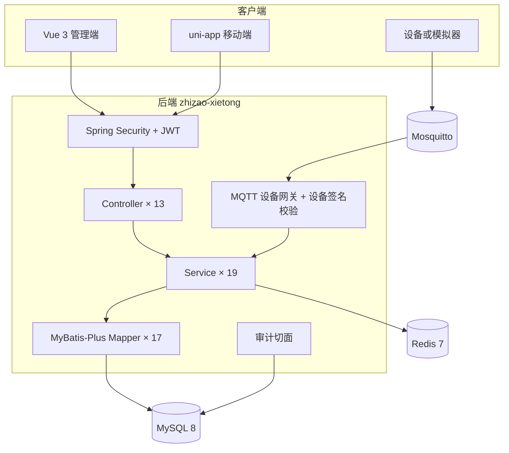
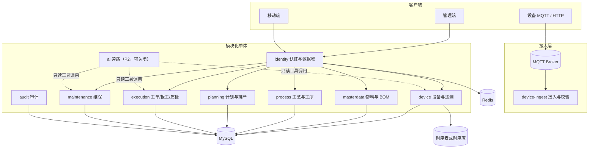
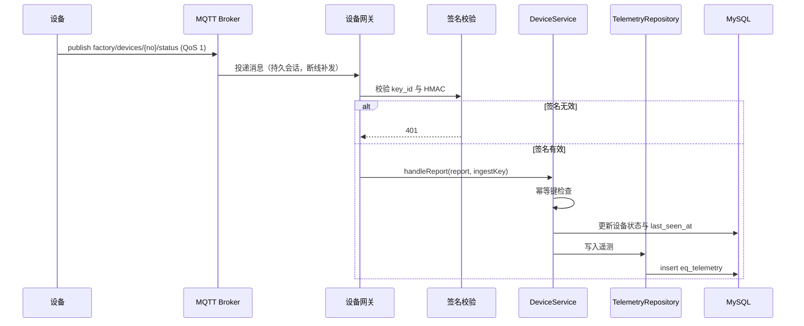

# 工程设计与重构方案

| 项 | 内容 |
|---|---|
| 文档状态 | 已评审通过（2026-11-06），进入 S0 实施 |
| 版本 | 1.0 |
| 日期 | 2026-11-06 |
| 适用仓库 | Industrial Application（离散制造 MES） |
| 文档类型 | 综合设计文档：现状盘点 + 目标架构 + 数据设计 + 接口设计 + 重构分期 |
| 系统阶段 | Brownfield 重构 |
| 主要读者 | 设计评审人、后端工程师、前端工程师、测试、运维 |
| 上游材料 | 现有代码与迁移脚本（逆向梳理），无独立 PRD |

标注说明：`[代码实证]` 表示可从当前代码、迁移脚本或命令输出直接核对；`[工程判断]` 表示基于现有规模与约束提出的设计取舍；`[待确认]` 表示需要用户拍板。

配套文档：

- [DATA-MODEL.md](DATA-MODEL.md)：26 张现状表 + 5 个只读视图与目标表设计
- [API-CONTRACT.md](API-CONTRACT.md)：87 个现状端点与目标端点
- [REFACTOR-PLAN.md](REFACTOR-PLAN.md)：S0–S8 分期、验收与风险

---

## 1. 范围

本次重构覆盖后端、管理端、移动端与部署脚本，目标是把一个可演示的 MES 原型补成可支撑简历描述与真实运行的工程项目。范围包括设备接入可靠性、遥测时序、工单一致性、工艺路线、权限边界、测试与 CI，以及最后阶段可选的 AI 旁路能力。

不在本次范围：多工厂 SaaS 化、完整 APS 排程、预测性维护、自动视觉质检、微服务拆分、前端技术栈更换。`[工程判断]`

---

## 2. 现状盘点

### 2.1 规模与提交

| 指标 | 数值 | 证据 |
|---|---|---|
| 仓库提交 | 初始 1 个提交，整理阶段追加 3 个 | `git log --oneline` |
| 跟踪文件 | 351 个（S0 整理后 139 个，S1–S8 与后续 SSO、权限、成品入库、设备报警迭代新增代码、迁移、测试与文档） | `git ls-files \| wc -l` |
| Java 文件 | 239 个 / 22136 行 | 主代码 185 个 / 13640 行，测试 54 个 / 8496 行 |
| 后端分层 | 18 Controller、26 个 service 文件、24 Entity、24 Mapper、25 DTO、8 Enum | `src/main/java/com/zhizao` |
| 数据库 | 12 张表，3 个 Flyway 迁移（S0 基线）；当前 26 张表 + 5 个只读视图、30 个迁移（编号 V1–V32，V27/V28 空号） | `src/main/resources/db/migration` |
| 管理端 | Vue 3 + TypeScript，12 个页面组件 | `zhizao-xietong-web/src` |
| 移动端 | uni-app，4 个页面（页面 `.vue` 共 734 行） | `mobile-app/pages` |
| 测试 | 19 个用例（S0 基线）；当前 366 个（348 单元 + 18 Testcontainers 集成），全部通过 | `mvn -o clean test` |
| CI | GitHub Actions 执行提交信息校验、密钥扫描、后端测试与前端构建，main 分支已开启保护 | `.github/workflows/ci.yml` |
| 端点 | 87 个（认证 6、用户 9、审计 1、设备 6、设备数据 4、物料 5、工艺 13、BOM 4、计划 6、工单 7、维保 5、设备凭证 2、排程 3、指标 1、AI 3、成品入库 4、设备报警 8） | 见 [API-CONTRACT.md](API-CONTRACT.md) |

仓库不是空壳。后端有真实 MQTT 接入、真实状态机、真实齐套计算和真实数据库迁移；主要问题集中在可靠性、并发正确性、数据留痕与工程化配套，而不是「有没有实现」。`[代码实证]`

### 2.2 现状分层与包结构

图中请求有两条入口：管理端与移动端经 JWT 过滤器进入 Controller；设备经 MQTT Broker 进入网关，再由 Service 落库。Redis 目前只承担缓存，审计切面绕过 Service 直接写日志表。

| 包 | 文件数 | 职责 | 关键类 |
|---|---|---|---|
| `controller` | 13 | REST 入口与鉴权注解 | `WorkOrderController`、`DeviceDataController`、`UserController` |
| `service` | 19 | 业务编排、状态机、齐套、编号、排产、用户与审计 | `WorkOrderService`、`KitCheckService`、`CodeGenerator`、`UserService` |
| `gateway` | 1 | MQTT 订阅与上报解析 | `MqttDeviceGateway` |
| `security` | 7 | JWT 生成、解析、过滤器、主体与数据域 | `JwtUtil`、`JwtAuthenticationFilter`、`DataScope` |
| `entity` / `mapper` | 17 / 17 | 持久化模型与访问 | `WorkOrder`、`WorkOrderMapper` |
| `dto` | 13 | 请求与响应 | `ReportRequest`、`QcRequest`、`UserView` |
| `common` | 10 | 返回体、分页、异常、限流端口与本地实现 | `Result`、`GlobalExceptionHandler`、`LoginRateLimiter` |
| `config` | 3 | Redis、OpenAPI、初始化数据 | `RedisConfig`、`DataInitializer` |
| `aspect` | 1 | 写操作审计 | `AuditAspect` |

### 2.3 数据模型摘要

12 张表与 12 个实体一一对应：设备、物料、工艺、BOM、计划、工单、报工、质检、维保、用户、序列、审计。表间没有物理外键，关系由业务代码维护。完整的字段、索引与目标变更见 [DATA-MODEL.md](DATA-MODEL.md)。

### 2.4 真实实现与模拟边界

| 能力 | 现状判定 | 证据 | 说明 |
|---|---|---|---|
| MQTT 设备接入 | 真实，但重连有缺陷 | `gateway/MqttDeviceGateway.java:56-85` | 使用 Paho 真实连接；`cleanSession(true)` 配合自动重连会丢失订阅；首次连接失败最多重试 10 次后停止 |
| 上报协议解析 | 真实 | `dto/DeviceGatewayReport.java`、`DeviceDataService.handleGatewayReport` | JSON 字段映射到设备状态与遥测 |
| 实时遥测 | 半模拟 | `service/DeviceDataService.java:42-50` | 有真实上报时返回上报值；无上报时用 `Random` 生成温度、转速、电流、OEE |
| 最新遥测缓存 | 内存 | `service/DeviceDataService.java:27` | `ConcurrentHashMap` 保存最近一次上报，重启即丢 |
| 工单闭环 | 真实 | `service/WorkOrderService.java:79-153` | 开工校验工艺与齐套，报工写记录，质检 PASS/FAIL 分支，完工联动计划 |
| 工单状态机 | 真实，无留痕 | `service/WorkOrderStateMachine.java` | 白名单流转；只改状态字段，没有流转历史表 |
| 工单并发 | 无保护 | `service/WorkOrderService.java:94-95`、`119-120` | `updateById` 无版本号，两个请求可同时开工 |
| 报工数量 | 无约束 | `dto/ReportRequest.java`、`WorkOrderService.java:103-121` | 数量可为空、可为负，合格数加不良数不校验，累计不校验 |
| 工艺路线 | 半成品 | `db/migration/V1__init.sql:39-54` | 只有工艺主表和描述字段，没有工序、工步、标准工时 |
| BOM | 真实可写，随工艺版本冻结 | `service/BomItemService.java` | 已有 CRUD；版本接口已在 S4 移除，`pr_bom` 只按 `process_id` 归属工艺版本行；发布后只读 |
| 齐套校验 | 真实 | `service/KitCheckService.java:30-59` | 按最新 BOM 计算「单件用量 × 工单数量」，库存不足即缺料 |
| 排产 | 有限贪心（S5） | `service/ScheduleService.java` | 按交期与优先级排队，在运行中设备上寻找时间窗；落不下返回业务码，结果落库可追溯，不做 APS |
| 编号生成 | 真实 | `service/CodeGenerator.java:26-34` | 数据库行锁按月自增，跨重启不重复 |
| 权限 | 真实，三级角色 + 车间数据域 | `security/SecurityConfig.java`、`security/DataScope.java` | JWT + `ADMIN`/`USER`/`WORKER`；过滤器逐请求查库校验 `enabled` 与 `token_version`，禁用或改密后下一次请求 401；非管理员按 `workshop_scope` 过滤设备、计划与工单。工单开工/报工允许三种角色，质检仅 `ADMIN`/`USER`，计划派工与其他管理动作仅 `ADMIN` |
| 登录限流 | 端口 + 单实例本地实现 | `common/LoginRateLimiter.java`、`common/LocalLoginRateLimiter.java` | 限流逻辑在端口后；本地 `ConcurrentHashMap` 滑动窗口，多实例部署必须替换为共享存储实现 |
| 审计 | 真实，可查询 | `aspect/AuditAspect.java`、`controller/AuditLogController.java` | 只审计非认证的写操作，参数截断 1000 字符；S6 增加按操作人/路径/日期查询与索引 |
| 多租户 | 无 | `db/migration/V1__init.sql` | 全库无 `tenant_id`；工单、设备与计划的 `workshop` 作为单车间数据域，不做多租户 |
| 管理端 | 真实调用后端 | `zhizao-xietong-web/src/views/Dashboard.vue` | KPI 与图表走真实分页接口，不是静态假数据 |
| 移动端 | 真实页面 | `mobile-app/pages` | 工单列表、工单详情、登录、修改密码四个页面，调用后端接口 |
| 测试 | 单测为主，集成补位 | `src/test/java` | 348 个 Mockito 单元用例，无 Spring 上下文；另有 18 个 Testcontainers 集成用例，覆盖状态机流转、乐观锁并发、工艺版本隔离、遥测入库、AI 只读会话与成品入库并发确认 |
| CI | S0 已补，后追加集成测试 | `.github/workflows/ci.yml` | 提交信息校验、密钥扫描、后端测试（含 Testcontainers，缺 Docker 自动跳过）、前端构建四条门禁 |

需要纠正的一点：BOM 在早期说明中被描述为只读，S4 之前已有新增、修改、删除与版本复制接口。S4 采用 A 方案后，版本由 `pr_process` 行表达，`pr_bom.version` 已由 V21 删除；真正的缺口变成「已发布版本仍可修改」，现已通过发布冻结与版本复制解决。`[代码实证]`

### 2.5 端点和测试基线

87 个端点按域分布：认证 6、用户 9、审计 1、设备 6、设备数据 4、物料 5、工艺 13（含工序 4 与版本复制 1）、BOM 4、计划 6、工单 7、维保 5、设备凭证 2、排程 3、指标 1、AI 旁路 3、成品入库 4、设备报警 8。S0 基线为 19 个测试：工单服务 8 个、齐套 5 个、认证 3 个、设备数据 2 个、编号 1 个；S1 后为 29 个；S2 后为 37 个，新增设备签名 6 个、指数退避 1 个、遥测保留 2 个，设备数据用例扩到 11 个；S3 后为 44 个，新增乐观锁冲突、历史留痕、报工数量边界与状态机用例 7 个；报工幂等后为 49 个，新增同键重发与键长边界单测 2 个、Testcontainers 集成用例 3 个（合法流转、非法流转、并发开始仅推进一次）；S4 后为 65 个，新增提交审批校验、发布冻结、版本复制、工序重复序号、BOM 重复物料与齐套版本隔离单测 16 个；S5 后为 75 个，新增排程边界 8 个（刚好排满、超出一点、同类型竞争、空产能、重排不改在产、幂等重跑、缺工时被拒、显式估算）与下达校验 2 个；S6 后为 111 个（108 单元 + 3 集成），新增认证即时失效、过滤器逐请求校验、HTTP 401、限流阈值、用户启停与改密、车间分配、审计查询与脱敏、设备/计划/工单车间过滤共 36 个单元用例。S7 后为 120 个（117 单元 + 3 集成），新增业务指标空分母与计数、指标概览降级说明、请求 traceId 共 9 个单元用例；S8 后为 140 个（137 单元 + 3 集成），新增开关关闭返回 503、三场景离线假模型、模型失败降级、非 ADMIN 拒绝、SQL 白名单、写操作零调用与「模型输出不当作指令」共 20 个单元用例。后续 SSO 登录提示与 `state` 校验、工单写操作角色控制、用户自助查询与角色分配、工艺版本隔离与 AI 只读会话集成用例补齐后为 280 个（269 单元 + 11 集成）；成品入库、设备报警、认证事件与用户创建/软删补齐后为 366 个（348 单元 + 18 集成）。集成用例依赖 Docker，缺失时明确跳过并输出提示，不影响本地与 CI 构建。`[代码实证]`

---

## 3. 目标架构

### 3.1 架构风格

采用模块化单体（modular monolith），保留单一部署单元与单一数据库，在包边界上做模块化。理由是：当前团队与部署规模不需要微服务带来的网络、事务和运维成本；设备接入与工单执行存在强事务关系，单体更容易保证一致性；后续如果 AI 旁路或报表出现独立伸缩需求，再按模块拆出进程。`[工程判断]`

### 3.2 目标组件图

图中主链路是「客户端 → identity → 业务模块 → MySQL」，设备链路是「设备 → MQTT → ingest → device → MySQL/时序存储」。AI 以虚线连接，只能调用只读工具，不进入主链路，关闭后不影响任何实线路径。`[工程判断]`

### 3.3 模块边界与依赖规则

| 模块 | 单句职责 | 允许依赖 | 明确不负责 |
|---|---|---|---|
| `identity` | 认证、角色、令牌、车间数据域 | 无业务模块 | 设备与工单业务 |
| `device` | 设备台账、状态、遥测写入与查询 | identity 的当前用户上下文 | 工单执行 |
| `masterdata` | 物料、库存、BOM 版本 | identity | 工艺审批 |
| `process` | 工艺主数据、工序、发布审批 | masterdata（校验物料） | 工单执行 |
| `planning` | 计划、下达、排产建议 | process、device | 报工质检 |
| `execution` | 工单状态机、报工、质检 | process、masterdata、device | 计划创建 |
| `maintenance` | 点检与维修记录 | device | 工单状态 |
| `audit` | 写操作审计与查询 | 无业务模块 | 业务判断 |
| `ai` | 只读建议与抽取 | device、execution、maintenance | 任何写操作 |

依赖方向必须无环：`execution → process → masterdata`，`planning → process/device`，`ai → 业务模块`，业务模块不得反向依赖 `ai`。跨模块调用走应用服务方法，不直接访问对方的 Mapper。`[工程判断]`

### 3.4 分层职责

| 层 | 职责 | 禁止 |
|---|---|---|
| Controller | HTTP 映射、参数校验、鉴权注解、DTO 转换 | 写业务规则、直接调用 Mapper |
| Application Service | 事务边界、跨模块编排、幂等与并发控制 | 处理 HTTP 细节、拼 SQL |
| Domain | 状态机、数量规则、齐套口径等纯业务判断 | 依赖 Spring Web、直接访问数据库 |
| Infrastructure | Mapper、MQTT、外部模型、缓存 | 反向依赖 Controller |

现状中 `AuditAspect` 直接写 `AuditLogMapper`，可以保留，但审计模块需要独立，避免其他模块复制这种绕过 Service 的写法。`[工程判断]`

### 3.5 技术选型与代价

| 能力 | 选择 | 理由 | 代价 |
|---|---|---|---|
| 时序存储 | 先 MySQL 单表，预留 `TelemetryRepository` 端口 | 当前数十台设备、秒级上报，MySQL 足够；少一个运维组件 | 长期高频写入需要分区或迁移时序库 |
| 缓存 | 继续 Redis | 已有依赖与配置；限流、热门主数据、令牌版本都适合放 Redis | 多一个可用性依赖，需要本地降级 |
| 消息 | 继续 MQTT，不引入 Kafka/RocketMQ | 设备接入天然适合 MQTT；当前没有第二个消费者 | 跨服务事件需要发件箱表补一致性 |
| 设备认证 | `key_id + HMAC-SHA256` | 设备凭证与用户令牌分离，泄露影响面小 | 需要密钥签发、轮换与吊销流程 |
| 权限 | Spring Security + JWT + 车间数据域 | 复用现有实现，改造成本低 | 完整多租户需要再引入 `tenant_id` |
| 排产 | 有限产能贪心排程 | 可解释、可测试，不引入求解器 | 无法处理复杂约束与全局最优 |
| AI | 外部模型 API + 端口隔离 + 假模型 | 旁路能力，必须可降级、可离线测试 | 模型成本、延迟与数据脱敏 |
| 前端 | 继续 Vue 3 + Element Plus + ECharts | 现有页面可复用，图表库已在用 | 不解决历史页面的交互细节 |

### 3.6 设备上报目标流程

流程的关键点是：订阅使用持久会话，重连后由连接完成回调重新订阅；消息先过签名与幂等，再更新设备状态；遥测写入失败只记录告警，不回滚设备状态，避免因为时序存储抖动导致设备状态无法更新。`[工程判断]`

---

## 4. 数据模型摘要

目标模型新增 4 张核心表：`eq_telemetry`（遥测时序）、`eq_device_credential`（设备凭证）、`pr_operation`（工序）、`wo_status_history`（工单流转历史）；另有可选的 `sys_outbox` 与两张 AI 审计表（S8 已落地：`ai_suggestion_log`、`ai_query_audit`）。现有表补充乐观锁版本、累计数量、车间归属、令牌版本、审计耗时等字段。

详细字段、索引、保留策略与迁移顺序见 [DATA-MODEL.md](DATA-MODEL.md)。

---

## 5. 接口摘要

现状 87 个端点：S4 移除了 BOM 版本端点 2 个，S5 新增排程端点 2 个，S6 新增用户管理 4 个与审计查询 1 个，S7 新增指标概览 1 个，S8 新增 AI 旁路 3 个；后续迭代补登 SSO 3 个、登出 1 个、用户自助查询与角色分配 2 个、排程设备时间轴 1 个、工单状态统计 1 个；S9 新增成品入库 4 个、设备报警（规则与记录）8 个、用户创建与软删 2 个。其余路径保留，其中约 20 个已经收紧行为或调整请求体：登录与刷新、设备状态、遥测与集成、物料库存字段、工艺审批、BOM 读写、计划更新与下达、开工报工质检、维保创建。目标新增端点已全部落地：设备凭证 2 个（S1）、遥测历史 1 个（S2）、工单历史 1 个（S3）、工序维护 4 个（S4）、版本复制 1 个（S4）、排程 2 个（S5）、用户与审计 5 个（S6）、指标概览 1 个（S7）、AI 建议与问答 3 个（S8）。

完整清单与契约见 [API-CONTRACT.md](API-CONTRACT.md)。

---

## 6. 重构分期摘要

| 阶段 | 优先级 | 主题 | 规模 | 关键验收 |
|---|---|---|---|---|
| S0 | P0 | 文档与 CI 基线 | S | 后端测试与前端构建进 CI |
| S1 | P0 | 设备接入可靠性 | M | 断线 30 秒后自动恢复订阅，重复上报去重 |
| S2 | P0 | 遥测时序存储 | M | 上报落库，可按时间范围查询 |
| S3 | P0 | 工单执行一致性 | M | 并发开工只有一个成功，状态有历史，数量有约束 |
| S4 | P1 | 工艺路线与 BOM | L | 工序可维护，发布冻结，齐套按版本 |
| S5 | P1 | 计划与排产 | M | 下达指定工艺，有限产能排程可解释 |
| S6 | P1 | 权限与数据域 | M | 禁用用户立即失效，跨车间拒绝 |
| S7 | P1 | 可观测性与前端 | M | 指标可见，历史曲线与流转时间线可用 |
| S8 | P2 | AI 能力（已落地） | L | 默认关闭，假模型测试，建议不写库 |

详细目标、涉及文件、验收标准与风险见 [REFACTOR-PLAN.md](REFACTOR-PLAN.md)。

---

## 7. 不变量

以下行为在重构中必须保持。任何阶段如果必须改变，先改本文档并取得确认。

### 7.1 工单状态与流转

| 不变量 | 内容 | 现状证据 |
|---|---|---|
| 状态集合 | `PENDING`、`IN_PRODUCTION`、`PENDING_QC`、`FINISHED` 四个状态，不新增隐藏状态 | `enums/WorkOrderStatus.java` |
| 合法流转 | `PENDING → IN_PRODUCTION`、`IN_PRODUCTION → PENDING_QC`、`PENDING_QC → FINISHED`、`PENDING_QC → IN_PRODUCTION` | `service/WorkOrderStateMachine.java` |
| 终态 | `FINISHED` 不允许再流转 | 同上 |
| 开工前置 | 工单必须绑定已发布工艺，且物料齐套 | `service/WorkOrderService.java:81-93` |
| 报工前置 | 仅「生产中」可报工 | `service/WorkOrderService.java:105-107` |
| 质检前置 | 仅「待质检」可质检；PASS 才完工，FAIL 退回生产 | `service/WorkOrderService.java:128-151` |
| 计划联动 | 计划下所有工单完工后，计划置为 `FINISHED` | `service/WorkOrderService.java:156-166` |

禁止事项：为了「方便」允许 `PENDING` 直接 `FINISHED`；为了「容错」在非法流转时静默忽略；为了「重试」自动重复报工。

### 7.2 齐套口径

- 需求公式：`需求 = 单件用量 × 工单数量`。当前 BOM 取该工艺的最新版本；S4 改为工单创建时锁定的工艺版本，版本来源变化必须单独评审，公式不变。`[代码实证]`
- 库存 `stock < 需求` 即为缺料，缺料项全部返回，不是遇到第一个就返回。
- 工艺未绑定或 BOM 为空视为「未配置 BOM」：齐套校验显式失败并返回明确原因，不能判为齐套通过，也不把原因伪装成缺料。`[代码实证]`
- 新增损耗率后，需求公式变为 `单件用量 × 工单数量 × (1 + 损耗率)`，必须有测试锁定新旧口径差异。`[待确认]`

### 7.3 编号规则

- 格式：`前缀-yyyyMM-4 位流水`，前缀为 `EQ/MN/MT/PR/PO/WO/RP/QC`。
- 序号按月分段，数据库行锁自增，跨重启不重复。
- 编号一经生成不可修改：设备、工艺、计划的更新接口会把编号置空，MyBatis-Plus 默认忽略 null 字段，从而保持原编号不变。`[代码实证]`

### 7.4 鉴权与审计

- `/api/auth/**`、Swagger、健康检查之外的所有端点必须认证；设备鉴权开启时 `/api/integration/device-status` 也放行，由 HMAC 校验替代用户令牌。
- 管理类写操作要求 ADMIN；工单开工/报工允许 `ADMIN`/`USER`/`WORKER`，质检允许 `ADMIN`/`USER`。
- 所有非认证的 POST/PUT/DELETE 必须写审计，审计失败不影响业务，但必须可观测。
- 审计记录包含操作人、方法、路径、类方法、参数摘要、IP、时间。
- 令牌过期时间默认 24 小时；刷新不得延长超过配置上限。

### 7.5 工艺审批与设备状态

- 工艺只能 `DRAFT → PENDING → PUBLISHED/REJECTED`；更新接口不得直接改审批状态。`[代码实证]`
- 设备状态只能取 `STOPPED/RUNNING/MAINTENANCE/SCRAPPED`；非法值必须拒绝。`[代码实证]`

### 7.6 接口契约

- 成功响应固定 `{code:0,message:"success",data}`；分页固定 `{total,records}`。
- 字段命名与路径保持不变；新增字段只能追加。
- 破坏性变更走 `/api/v2`，旧路径至少保留一个迭代。

### 7.7 AI 硬约束

这些约束与 7.1–7.6 同级，不得因为引入 AI 而放松。

| 约束 | 具体要求 | 违反判定 |
|---|---|---|
| 旁路运行 | AI 处于主链路之外，可整体关闭；AI 组件不可用不得影响下单、报工、状态流转、设备接入 | 任何业务请求因为 AI 超时或异常而失败 |
| 只建议不写库 | 模型输出只能作为建议返回和记录，不得直接修改工单状态、数量、库存、设备状态 | AI 代码调用写接口或写业务表 |
| 工具只读 | Agent 只能调用现有后端的只读查询能力，不提供写工具 | 出现 `update/insert/delete` 工具 |
| 离线可测 | 每个 AI 用例必须有假模型测试，CI 不访问外部模型、不依赖 API key | CI 需要网络或密钥才能通过 |
| 降级明确 | AI 关闭或失败时返回 `503` 或明确的「暂不可用」，不返回伪造结果 | 返回编造的原因或数量 |
| 数据最小化 | 发送给模型的内容去除姓名、联系方式等个人信息；日志不存完整原文 | 日志或建议记录出现敏感个人信息 |

---

## 8. AI 能力（S8，已落地）

### 8.1 定位

AI 是旁路能力，已在 S8 落地，默认关闭且可整体关闭。它的价值在于减少查找和录入成本，不承担生产决策。形态是「后端建议接口 + Agent 调用现有只读能力」，不在管理端挂一个通用聊天框。`[工程判断]`

### 8.2 场景一：设备异常归因与处置建议

触发方式：设备详情页出现异常状态或人工点击「分析异常」；输入设备编号与时间窗。

处理流程：

1. 规则初筛：设备状态非 `RUNNING`、温度或电流超过阈值。
2. 检索历史：查最近 180 天 `eq_maintenance`、该设备相关工单的质检 FAIL 记录，以及当前设备遥测窗口。
3. 模型归纳：输入结构化摘要与检索到的记录 ID，输出 JSON：可能原因、建议动作、参考维修记录、置信度、免责声明。
4. 返回与留痕：写入 `ai_suggestion_log`，页面以卡片展示；不自动创维保记录，不改设备状态。

约束：每条原因必须引用至少一条输入记录或指标；置信度低时明确写「建议人工判断」；建议动作只能是「检查/清洁/更换/停机检修」等文本，不生成工单。

### 8.3 场景二：自然语言报工

触发方式：移动端报工页的文本输入，或语音转文字后填入。

处理流程：

1. 模型只做抽取：从「3 号机加工了 50 件，合格 48，不良 2」中抽取 `qty`、`qualifiedQty`、`defectQty`、`operator`、`remark`。
2. 输出映射到现有 `ReportRequest`，字段缺失或歧义时返回待补全字段，不猜测数量。
3. 复用现有校验：工单状态、数量正数、合格加不良等于总数、累计不超过工单数量、幂等键。
4. 用户确认后才调用现有报工接口；模型不直接提交，不直接改状态。

语音不是必需项：先做文本抽取，语音依赖端侧或第三方 ASR，作为可选输入方式，失败时回退到手工输入。`[工程判断]`

### 8.4 场景三：生产数据问答

触发方式：管理端「数据问答」，仅 ADMIN 开放。

约束优先于体验：

- 只连只读数据库账号或只读视图，不连业务写库账号。
- 只允许 `SELECT`，拒绝 DDL、DML、多语句、注释注入与非白名单表。
- 表白名单：`v_work_order_summary`、`v_device_status`、`v_quality_summary`、`v_plan_progress`、`v_kit_status`。
- 字段白名单：视图只暴露业务需要字段，不暴露密码、密钥、审计参数。
- 权限过滤：仅 ADMIN 可调用；管理员本身不受车间数据域限制，因此不注入车间条件，非管理员在 Controller 与 Service 两层都会被拒绝。
- 强制 `LIMIT 200`，语句超时 3 秒，返回行数上限 200。
- 每次查询记录生成的 SQL、耗时、行数到 `ai_query_audit`；管理端可查看 SQL。
- 高频问题优先走预置查询模板，模型只做参数抽取；模板覆盖不了时才走 Text-to-SQL。

风险：模型可能生成错误 JOIN、构造慢查询或尝试写操作。缓解方式是仅 ADMIN、只读视图白名单、强制 LIMIT、超时、SQL 审计与结果展示 SQL 供核对；不做「模型直连生产库」。`[工程判断]`

### 8.5 明确不做

| 不做 | 理由 |
|---|---|
| 模型直接排产 | 排产是带约束的优化问题，需要确定性、可解释与责任边界；当前贪心排程已能满足演示与基本使用，模型输出无法保证交期与设备占用正确 |
| 预测性维护 | 当前没有足够的故障标签与长周期数据，误报会造成不必要的停机；等遥测积累 12 个月并形成维修标签后再评估 |
| 全自动质检 | 需要视觉硬件、缺陷样本与标注体系，误判直接影响质量与安全责任；现阶段保留人工质检 |
| 通用聊天框 | 与业务动作脱节，容易变成演示噱头；采用场景化入口，输出直接嵌入设备详情与报工表单 |

### 8.6 Agent 工具清单与权限边界

| 工具 | 复用的现有能力 | 读写 | 权限边界 |
|---|---|---|---|
| `get_device_status` | `DeviceService.getById` + 最新遥测 | 读 | 只能看当前用户车间设备 |
| `get_device_telemetry` | 遥测历史查询 | 读 | 同上，最多 50 条 |
| `check_kit` | `KitCheckService.check` | 读 | 只能对当前用户可见工单计算 |
| `get_work_order` | `WorkOrderService.getById` | 读 | 车间范围校验 |
| `list_maintenance` | 维保记录只读查询（先校验设备归属） | 读 | 按设备范围过滤 |
| `list_quality_failures` | 质检记录只读查询 | 读 | 同上 |
| `get_process_bom` | `BomItemService.listByProcess` | 读 | 只读，不含成本字段 |

工具通过现有 Service 或只读查询构造器调用，不拼原始 SQL；工具入参必须校验归属；全部只读，P2 不提供写工具。若未来增加「创建维保建议」这类写工具，必须单独评审并加二次确认。`[工程判断]`

### 8.7 阶段与依赖

| 项 | 内容 |
|---|---|
| 阶段 | S8，优先级 P2，已落地，可整体关闭 |
| 前置 | S1 设备状态与在线判定、S2 遥测历史、S3 工单历史与数量约束、S6 数据域 |
| 规模 | 已交付 `ai` 包、2 张审计表、5 个只读视图、3 个场景与 20 个离线假模型用例 |
| 对主链路影响 | 无；开关 `ai.enabled` 默认 false |
| 上线顺序 | 先场景一（只读建议），再场景二（抽取 + 人工确认），最后场景三（Text-to-SQL，仅 ADMIN） |

### 8.8 验收与降级

- `ai.enabled=false`：AI 端点返回 HTTP 503 + 业务码 503，其他 70 个端点行为不变。
- 模型超时（默认 5 秒）：返回「建议暂不可用」，不重试、不影响当前页面其他操作。
- 假模型测试覆盖：设备归因证据、报工字段抽取与缺失保留、Text-to-SQL 白名单、模型失败降级、非 ADMIN 拒绝、写 SQL 拒绝，以及「模型返回内容不被当作指令执行」。
- 输出必须通过字段、证据与置信度校验；校验失败按「不可用」处理，不展示半成品。
- CI 不配置任何模型密钥；真实模型只在本地或预发环境通过 `AI_PROVIDER=external` 手工验证。

---

## 9. 已决策

决策日期：2026-11-06。以下取值已确认，作为 S0–S8 的实施基线；后续如需变更，新增决策记录并注明影响阶段，不直接改写本节结论。

| # | 决策点 | 最终取值 | 状态 |
|---|---|---|---|
| 1 | 时序存储选型 | 先 MySQL 单表 + 90 天保留，预留 Repository 端口；超过 200 台设备或亚秒级上报再评估时序库 | 已决策 |
| 2 | 模拟遥测是否保留 | 保留为显式演示开关，默认关闭，返回 `source=SIMULATED`；不再静默返回随机数 | 已决策 |
| 3 | 比赛材料范围 | 赛事通知、参赛方案、答辩指导书、PPT 工作目录已删除；两份 docx（PRD、开发文档）保留，移入 `docs/legacy/`，原始内容不裁剪，标注「历史资料，未随重构维护」 | 已决策 |
| 4 | 多租户还是车间数据域 | 本阶段做车间数据域，不引入完整 `tenant_id`；SaaS 化时再评估 | 已决策 |
| 5 | 是否引入 Kafka/RocketMQ | 暂不引入；保留 `sys_outbox` 作为可选预案，仅在出现第二个消费者时启用 | 已决策 |
| 6 | 设备认证方式 | `key_id + HMAC-SHA256`，密钥可轮换与吊销，设备不复用用户 JWT | 已决策 |
| 7 | 工艺流程深度 | 单级工序（`pr_operation`），不做工步 | 已决策 |
| 8 | 排产算法 | 有限产能贪心排程，不做 APS 求解器 | 已决策 |
| 9 | 报工是否允许多次累计 | 已支持多次累计：每次报工留在「生产中」并累加，仅当剩余可报数量为 0 时在同一事务内转「待质检」；报满前不可送检，质检不可跳过（PASS 才完工）；质检 FAIL 按「本轮全部报工数」释放返工额度 | 已决策 |
| 10 | AI 模型与数据边界 | 优先私有化或境内合规模型，密钥只放环境变量，输入脱敏，不可用时降级 | 已决策 |
| 11 | Text-to-SQL 开放范围 | 首期仅 ADMIN，只读视图，服务端注入车间过滤 | 已决策 |
| 12 | 文档确认方式 | 本文件与 3 个子文档评审通过，进入 S0/S1；代码改动以文档为基线 | 已决策 |

当前仍开放的事项只有一项：齐套计算是否引入损耗率（见 7.2），在 S4 设计 BOM 时单独确认。
